<p align="center">
  <picture>
    <source media="(prefers-color-scheme: dark)" srcset="assets/banner-dark.svg">
    
  </picture>
</p>

<h3 align="center"><i>Use <a href="https://github.com/obra/superpowers">Superpowers</a> to plan and build,<br>and Proofs to see and decide.</i></h3>

<p align="center">
  
  
  
</p>

Stop reading walls of terminal text. Every skill here includes a page you can look at, click through and decide on, then hand back to Claude in one paste. Design reviews, visual QA, copy edits and decision pages for [Claude Code](https://claude.com/claude-code): Claude builds the review, you choose from real options, and Claude builds what you chose.

In Claude Code:

```
/plugin marketplace add workingBen/proofs
/plugin install proofs@proofs
```

**[Browse the site](https://workingben.github.io/proofs/)** for all 10 skills and 230+ features, each with a short write-up.

<p align="center"><a href="assets/clips/proofs-30s.mp4"></a></p>

<p align="center"><sub>The 30-second tour. Every picture is a real page, before and after. <a href="assets/clips/proofs-30s.mp4">Full-size MP4</a> (1920x1080, silent).</sub></p>

<!-- examples:grid:start -->
## See it work

Real pages, before and after one review. [See all of them, as sliders](https://workingben.github.io/proofs/).

<table>
<tr><td colspan="2">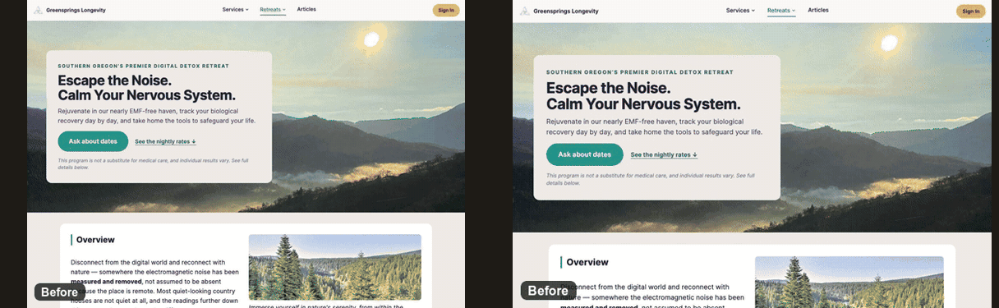</td></tr>
<tr><td width="50%" valign="top"><b><a href="https://workingben.github.io/proofs/design-review.html">design-review</a></b> · A pale boxed card becomes a full-bleed sunset hero.</td><td width="50%" valign="top"><b><a href="https://workingben.github.io/proofs/design-review.html">design-review</a></b> · A bare date picker gains the room photo and a teal stay.</td></tr>
<tr><td colspan="2">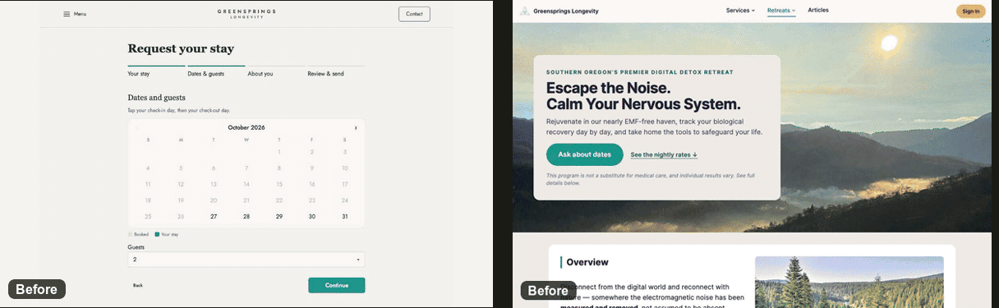</td></tr>
<tr><td width="50%" valign="top"><b><a href="https://workingben.github.io/proofs/article-copy-edit.html">article-copy-edit</a></b> · A plain sentence becomes a tracked edit with a claims check.</td><td width="50%" valign="top"><b><a href="https://workingben.github.io/proofs/design-review.html">design-review</a></b> · Three plain links become fanned stacks of real report pages.</td></tr>
</table>

<details>
<summary><b>More examples (4)</b></summary>

<table>
<tr><td colspan="2">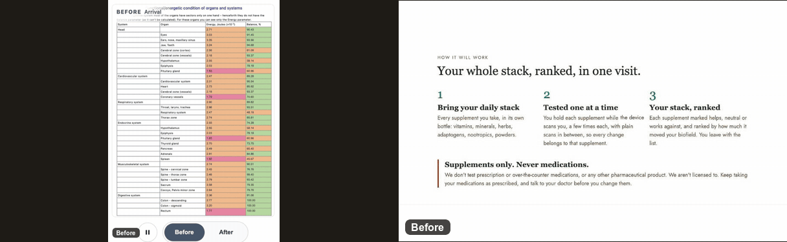</td></tr>
<tr><td width="50%" valign="top"><b><a href="https://workingben.github.io/proofs/design-review.html">design-review</a></b> · A text-only card back becomes a wildflower-photo card.</td><td width="50%" valign="top"><b><a href="https://workingben.github.io/proofs/design-review.html">design-review</a></b> · A text section gains a ranked green-to-red bar chart.</td></tr>
<tr><td colspan="2">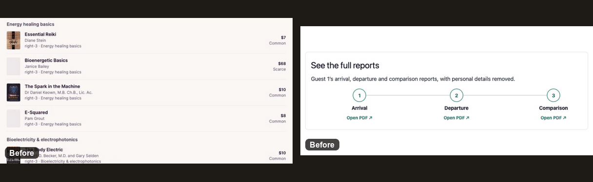</td></tr>
<tr><td width="50%" valign="top"><b><a href="https://workingben.github.io/proofs/design-review.html">design-review</a></b> · A dense readings table becomes seven colored range gauges.</td><td width="50%" valign="top"><b><a href="https://workingben.github.io/proofs/design-review.html">design-review</a></b> · A long Gantt list becomes a two-lane timeline.</td></tr>
</table>
</details>
<!-- examples:grid:end -->

## After installing

Ask for a skill by name, like `design review for /pricing`, or run `/proofs:visual-qa /checkout`. To get new versions later: `/plugin marketplace update proofs`.

No claude.ai artifacts? Pages open in your browser instead, or on your phone over Wi-Fi. See [Where the Page Goes](https://workingben.github.io/proofs/design-review.html#wp).

## How every skill works

<picture>
  <source media="(max-width: 700px) and (prefers-color-scheme: dark)" srcset="assets/how-it-works-steps-dark.svg">
  <source media="(max-width: 700px)" srcset="assets/how-it-works-steps-light.svg">
  <source media="(prefers-color-scheme: dark)" srcset="assets/how-it-works-row-dark.svg">
  
</picture>

Every skill below plugs into this loop.

### Why paste it back?

Because your agents keep working while you decide, and you can decide from anywhere, with nothing running on your computer. Tools that send your answers straight back to the agent are smoother, and they pay for it in other ways:

| | Agents keep working while you decide | Decide on your phone | Server on your computer |
| --- | --- | --- | --- |
| **Proofs** (one paste) | Yes | Yes, any device | None (a private claude.ai link) |
| [Lavish](https://github.com/kunchenguid/lavish-axi) | No, it waits for your feedback | With Tailscale | Yes |
| [make-pages-interactive](https://github.com/paraschopra/make-pages-interactive) | Yes, it watches an inbox | Not stated | Yes |

Both are good tools, and neither replaces our visual communication skills.

## Works with Superpowers

[Superpowers](https://github.com/obra/superpowers) is the best-known workflow skill set for Claude Code (brainstorming, plans, writing tests first, subagents), and it is excellent. It works as text in the terminal. Proofs sits next to it as the visual decision layer, not a rival: use Superpowers to plan and build, and Proofs to see and decide. This project has no affiliation with or endorsement from Superpowers.

## Four skills up close

### design-review: see your live page beside real mockups, then approve what ships


Claude puts a real screenshot of your page next to one to three working mockups per section. You pick one, and Claude builds it.

- A real screenshot as the Before
- Mockups drawn in your site's own fonts, colors and spacing
- One decision per item, then one paste back

[Read the design-review page](https://workingben.github.io/proofs/design-review.html)

### visual-qa: measure your pages the way people see them, then fix what fails

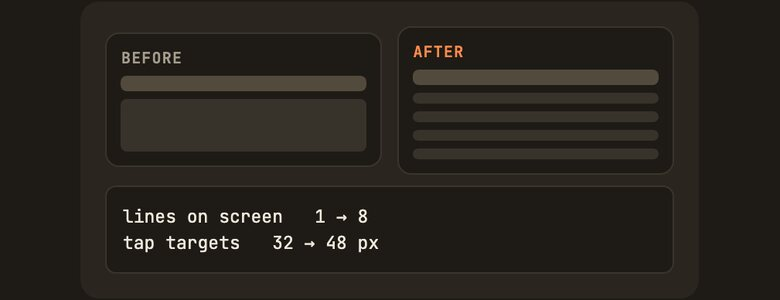

Opens every page at desktop, laptop and phone sizes and measures it: text too small, tap targets too tight, text cut off, too few items on the first screen. Every problem gets a mockup fix, and you get a before and after.

- Real numbers, not opinions
- Before and after screenshots
- Hands its findings to design-review

[Read the visual-qa page](https://workingben.github.io/proofs/visual-qa.html)

### article-copy-edit: review copy edits word by word, with a claims check first


Shows the edits on a page styled like your real article. A claims check comes first, and nothing changes in your files until you have decided.

- Keep, use, comment or revise, per edit
- A reason on every suggestion
- Risky claims flagged before anything else

[Read the article-copy-edit page](https://workingben.github.io/proofs/article-copy-edit.html)

### working-log: a page Claude talks to you through when the terminal fails you

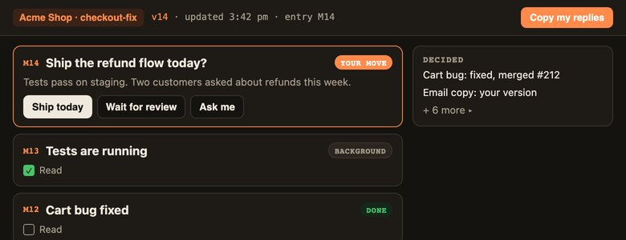

A newest-first log that Claude republishes as it works. Questions come with buttons, every entry has a read tick, and one Copy button sends your answers back.

- Nothing gets lost in the terminal
- Read it from your phone
- Answered items move to a Settled list

[Read the working-log page](https://workingben.github.io/proofs/working-log.html)

## All 10 skills

Grouped by what you are trying to do. Each name links to that skill's page.

**Decide before it's built**

<table>
<tr><td width="50%" valign="top"><a href="https://workingben.github.io/proofs/design-review.html"></a><br><b><a href="https://workingben.github.io/proofs/design-review.html">design-review</a></b> <br>Your live page next to one to three mockups per section. You pick, Claude builds it.</td><td width="50%" valign="top"><a href="https://workingben.github.io/proofs/article-copy-edit.html"></a><br><b><a href="https://workingben.github.io/proofs/article-copy-edit.html">article-copy-edit</a></b><br>Line edits shown on your real article, with a claims check first.</td></tr>
<tr><td width="50%" valign="top"><a href="https://workingben.github.io/proofs/photo-picker.html">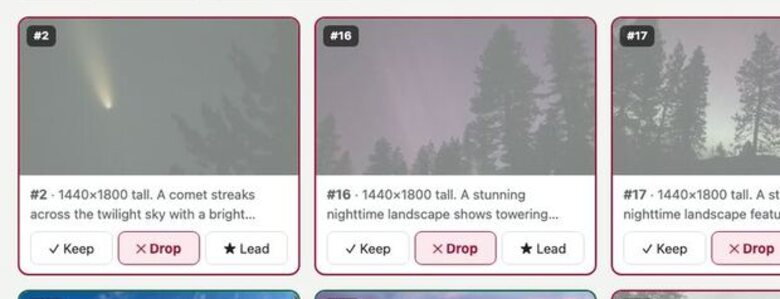</a><br><b><a href="https://workingben.github.io/proofs/photo-picker.html">photo-picker</a></b><br>Licensed photo candidates for every spot that needs one, in a gallery you choose from.</td><td width="50%" valign="top"><a href="https://workingben.github.io/proofs/style-guide.html">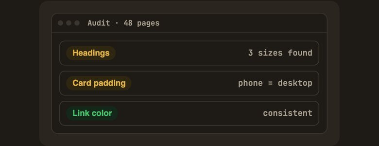</a><br><b><a href="https://workingben.github.io/proofs/style-guide.html">style-guide</a></b><br>Audits the whole site for one consistent look and saves the rules you accept.</td></tr>
</table>

**Check what's built**

<table>
<tr><td width="50%" valign="top"><a href="https://workingben.github.io/proofs/pr-qa.html">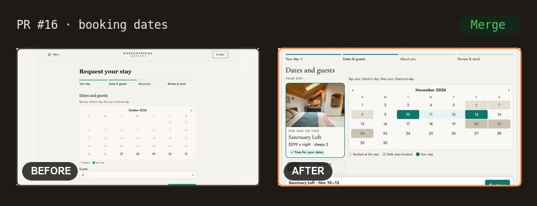</a><br><b><a href="https://workingben.github.io/proofs/pr-qa.html">pr-qa</a></b> <br>Before and after screenshots of each open pull request, with one decision per PR.</td><td width="50%" valign="top"><a href="https://workingben.github.io/proofs/visual-qa.html"></a><br><b><a href="https://workingben.github.io/proofs/visual-qa.html">visual-qa</a></b><br>Measures pages at three screen sizes, finds layout problems, and designs the fixes.</td></tr>
</table>

**Talk on a page, not in the terminal**

<table>
<tr><td width="50%" valign="top"><a href="https://workingben.github.io/proofs/working-log.html"></a><br><b><a href="https://workingben.github.io/proofs/working-log.html">working-log</a></b> <br>A newest-first log with read ticks, answer buttons and a Copy button.</td><td width="50%" valign="top"><a href="https://workingben.github.io/proofs/todos.html">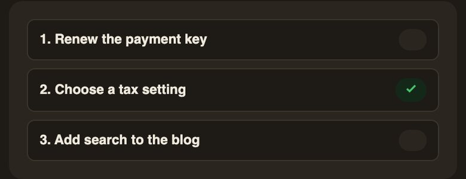</a><br><b><a href="https://workingben.github.io/proofs/todos.html">todos</a></b><br>Your to-do list as a tickable page. Done items are checked before they are archived.</td></tr>
</table>

**Keep long sessions on track**

<table>
<tr><td width="50%" valign="top"><a href="https://workingben.github.io/proofs/review-cycle.html">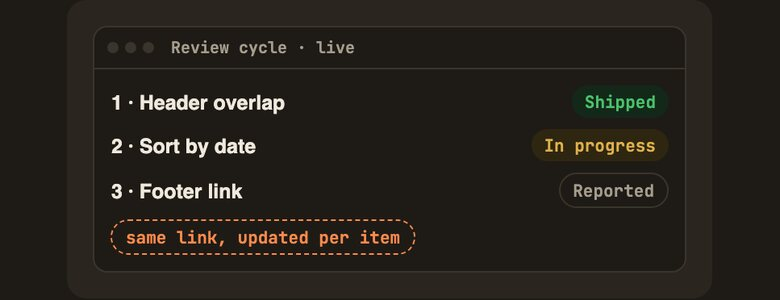</a><br><b><a href="https://workingben.github.io/proofs/review-cycle.html">review-cycle</a></b><br>Report bugs and ideas as they come; each is fixed, reviewed or saved for later.</td><td width="50%" valign="top"><a href="https://workingben.github.io/proofs/changelog.html">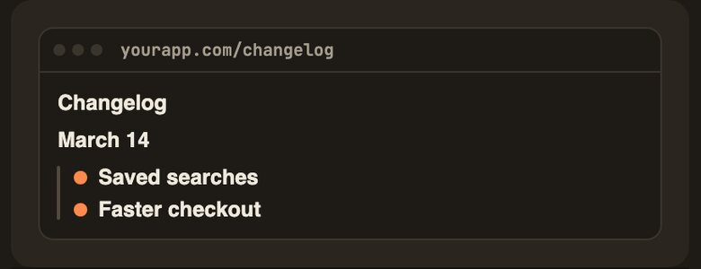</a><br><b><a href="https://workingben.github.io/proofs/changelog.html">changelog</a></b><br>A "What's new" page split by month, updated at the end of every session that ships something.</td></tr>
</table>

## FAQ

<details>
<summary>Do I need anything besides Claude Code?</summary>

<br>

Review pages are published as Claude artifacts when you have them, and open in your browser otherwise. Beyond that, a few skills need small extras:

- **Python 3** for todos and pr-qa (their scripts use only the standard library).
- **`gh` (the GitHub CLI) or a GitHub token** for pr-qa.
- **Node and Playwright** for visual-qa and for screenshots.
- **Superpowers** is optional. review-cycle uses it when it is installed and works without it.

</details>

<details>
<summary>Will these work in my stack?</summary>

<br>

The skills were built on Rails sites, but each one asks your project how it builds, tests and deploys instead of assuming.

</details>

<details>
<summary>Can I change a skill for my own team?</summary>

<br>

Yes. Fork it, or put your house rules in your own `CLAUDE.md` and the skills will follow them.

</details>

## License

MIT. Made with Claude Code. Improvements welcome. See [LICENSE](LICENSE).
