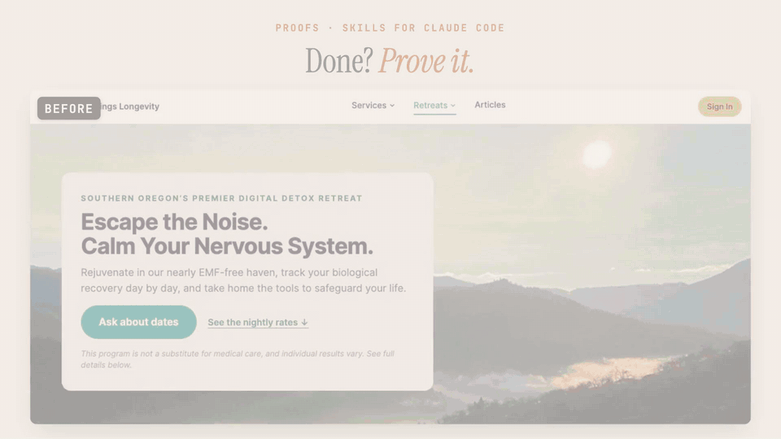
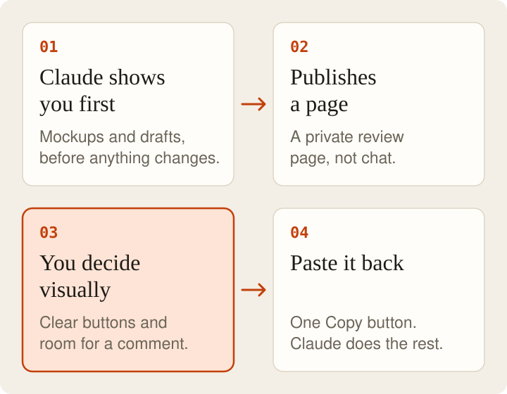
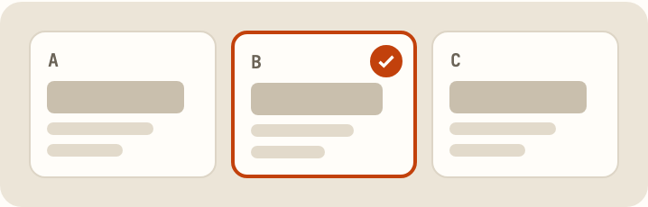
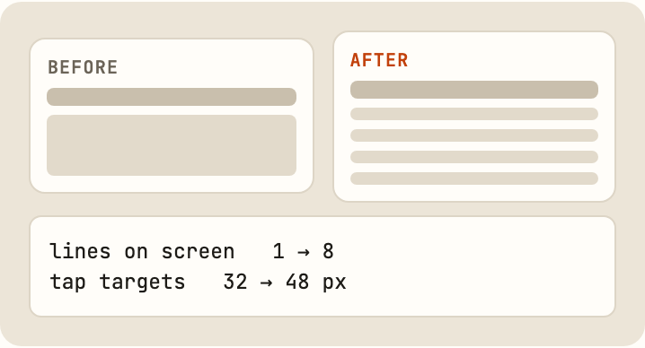
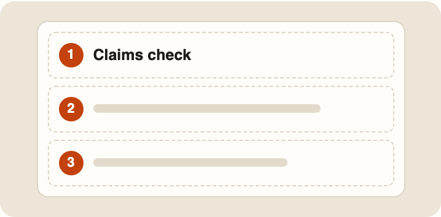
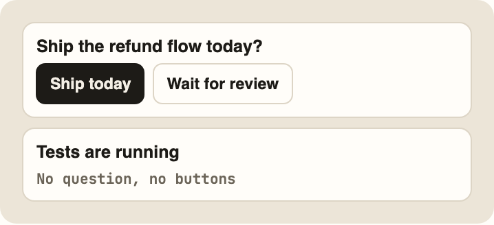

<p align="center">
  <picture>
    <source media="(prefers-color-scheme: dark)" srcset="assets/banner-dark.svg">
    
  </picture>
</p>

<p align="center">
  
  
  
</p>

Stop reading walls of terminal text. Every skill here includes a page you can look at, click through and decide on, then hand back to Claude in one paste. Design reviews, visual QA, copy edits and decision pages for [Claude Code](https://claude.com/claude-code): Claude builds the review, you choose from real options, and Claude builds what you chose.

In Claude Code:

```
/plugin marketplace add workingBen/proofs
/plugin install proofs@proofs
```

**[Browse the site](https://workingben.github.io/proofs/)** for all 10 skills and 230+ features, each with a short write-up.

<p align="center"><a href="assets/clips/proofs-30s.mp4"></a></p>

<p align="center"><sub>The 30-second tour. Every picture is a real page, before and after. <a href="assets/clips/proofs-30s.mp4">Full-size MP4</a> (1920x1080, silent).</sub></p>

<!-- examples:grid:start -->
## See it work

Real pages, before and after one review. [See all of them, as sliders](https://workingben.github.io/proofs/).

<table>
<tr><td colspan="2"></td></tr>
<tr><td width="50%" valign="top"><b><a href="https://workingben.github.io/proofs/design-review.html">design-review</a></b> · A pale boxed card becomes a full-bleed sunset hero.</td><td width="50%" valign="top"><b><a href="https://workingben.github.io/proofs/photo-picker.html">photo-picker</a></b> · A hazy hero, a photo picker, then a lupine hero.</td></tr>
<tr><td colspan="2"></td></tr>
<tr><td width="50%" valign="top"><b><a href="https://workingben.github.io/proofs/design-review.html">design-review</a></b> · A table of readings becomes before-and-after bed heat maps.</td><td width="50%" valign="top"><b><a href="https://workingben.github.io/proofs/design-review.html">design-review</a></b> · A lonely cover becomes a header with the cover beside the title.</td></tr>
<tr><td colspan="2"></td></tr>
<tr><td width="50%" valign="top"><b><a href="https://workingben.github.io/proofs/design-review.html">design-review</a></b> · A dense readings table becomes seven colored range gauges.</td><td width="50%" valign="top"><b><a href="https://workingben.github.io/proofs/design-review.html">design-review</a></b> · A text section gains a ranked green-to-red bar chart.</td></tr>
<tr><td colspan="2"></td></tr>
<tr><td width="50%" valign="top"><b><a href="https://workingben.github.io/proofs/design-review.html">design-review</a></b> · A text list becomes a wall of big book covers.</td><td width="50%" valign="top"><b><a href="https://workingben.github.io/proofs/design-review.html">design-review</a></b> · Three plain links become fanned stacks of real report pages.</td></tr>
</table>
<!-- examples:grid:end -->

## After installing

Ask for a skill by name, like `design review for /pricing`, or run `/proofs:visual-qa /checkout`. To get new versions later: `/plugin marketplace update proofs`.

No claude.ai artifacts? Pages open in your browser instead, or on your phone over Wi-Fi. See [Where the Page Goes](https://workingben.github.io/proofs/design-review.html#wp).

## How every skill works

<picture>
  <source media="(prefers-color-scheme: dark)" srcset="assets/how-it-works-dark.svg">
  
</picture>

Every skill below plugs into this loop.

## Works with Superpowers

[Superpowers](https://github.com/obra/superpowers) is the best-known workflow skill set for Claude Code (brainstorming, plans, writing tests first, subagents), and it is excellent. It works as text in the terminal. proofs sits next to it as the visual decision layer, not a rival: use Superpowers to plan and build, and proofs to see and decide. The two are independent projects, and this one has no affiliation with or endorsement from Superpowers.

## Four skills up close

### design-review: see your live page beside real mockups, then approve what ships

<picture>
  <source media="(prefers-color-scheme: dark)" srcset="assets/example-design-review-dark.png">
  
</picture>

Claude puts a real screenshot of your page next to one to three working mockups per section. You pick one, and Claude builds it.

- A real screenshot as the Before
- Mockups drawn in your site's own fonts, colors and spacing
- Four decisions per item, then one paste back

[Read the design-review page](https://workingben.github.io/proofs/design-review.html)

### visual-qa: measure your pages the way people see them, then fix what fails

<picture>
  <source media="(prefers-color-scheme: dark)" srcset="assets/example-visual-qa-dark.png">
  
</picture>

Opens every page at desktop, laptop and phone sizes and measures it: text too small, tap targets too tight, text cut off, too few items on the first screen. Every problem gets a mockup fix, and you get a before and after.

- Real numbers, not opinions
- Before and after screenshots
- Hands its findings to design-review

[Read the visual-qa page](https://workingben.github.io/proofs/visual-qa.html)

### article-copy-edit: review copy edits word by word, with a claims check first

<picture>
  <source media="(prefers-color-scheme: dark)" srcset="assets/example-article-copy-edit-dark.png">
  
</picture>

Shows the edits on a page styled like your real article. A claims check comes first, and nothing changes in your files until you have decided.

- Keep, use, comment or revise, per edit
- A reason on every suggestion
- Risky claims flagged before anything else

[Read the article-copy-edit page](https://workingben.github.io/proofs/article-copy-edit.html)

### working-log: a page Claude talks to you through when the terminal fails you

<picture>
  <source media="(prefers-color-scheme: dark)" srcset="assets/example-working-log-dark.png">
  
</picture>

A newest-first log that Claude republishes as it works. Questions come with buttons, every entry has a read tick, and one Copy button sends your answers back.

- Nothing gets lost in the terminal
- Read it from your phone
- Answered items move to a Settled list

[Read the working-log page](https://workingben.github.io/proofs/working-log.html)

## All 10 skills

Grouped by what you are trying to do. Each name links to that skill's page.

**Decide before it's built**

| Skill | What it does |
| --- | --- |
| [design-review](https://workingben.github.io/proofs/design-review.html) | Your live page next to one to three mockups per section. You pick, Claude builds it. |
| [article-copy-edit](https://workingben.github.io/proofs/article-copy-edit.html) | Line edits shown on your real article, with a claims check first. |
| [photo-picker](https://workingben.github.io/proofs/photo-picker.html) | Licensed photo candidates for every spot that needs one, in a gallery you choose from. |
| [style-guide](https://workingben.github.io/proofs/style-guide.html) | Audits the whole site for one consistent look and saves the rules you accept. |

**Check what's built**

| Skill | What it does |
| --- | --- |
| [visual-qa](https://workingben.github.io/proofs/visual-qa.html) | Measures pages at three screen sizes, finds layout problems, and designs the fixes. |
| [pr-qa](https://workingben.github.io/proofs/pr-qa.html) | Before and after screenshots of each open pull request, with one decision per PR. |

**Talk on a page, not in the terminal**

| Skill | What it does |
| --- | --- |
| [working-log](https://workingben.github.io/proofs/working-log.html) | A newest-first log with read ticks, answer buttons and a Copy button. |
| [todos](https://workingben.github.io/proofs/todos.html) | Your to-do list as a tickable page. Done items are checked before they are archived. |

**Keep long sessions on track**

| Skill | What it does |
| --- | --- |
| [review-cycle](https://workingben.github.io/proofs/review-cycle.html) | Send small bugs one at a time, often from your phone. Each one is finished before the next. |
| [changelog](https://workingben.github.io/proofs/changelog.html) | A "What's new" page split by month, updated at the end of every session that ships something. |

## FAQ

<details>
<summary>Do I need anything besides Claude Code?</summary>

<br>

Review pages are published as Claude artifacts when you have them, and open in your browser otherwise. Beyond that, a few skills need small extras:

- **Python 3** for todos and pr-qa (their scripts use only the standard library).
- **`gh` (the GitHub CLI) or a GitHub token** for pr-qa.
- **Node and Playwright** for visual-qa and for screenshots.
- **Superpowers** is optional. review-cycle uses it when it is installed and works without it.

</details>

<details>
<summary>Will these work in my stack?</summary>

<br>

The skills were built on Rails sites, but each one asks your project how it builds, tests and deploys instead of assuming.

</details>

<details>
<summary>Can I change a skill for my own team?</summary>

<br>

Yes. Fork it, or put your house rules in your own `CLAUDE.md` and the skills will follow them.

</details>

## License

MIT. Made with Claude Code. Improvements welcome. See [LICENSE](LICENSE).
