<p align="center">
  <picture>
    <source media="(max-width: 700px) and (prefers-color-scheme: dark)" srcset="assets/banner-mobile-dark.svg">
    <source media="(max-width: 700px)" srcset="assets/banner-mobile-light.svg">
    <source media="(prefers-color-scheme: dark)" srcset="assets/banner-dark.svg">
    
  </picture>
</p>

<h3 align="center"><i>Use <a href="https://github.com/obra/superpowers">Superpowers</a> to plan and build,<br>and Proofs to see and decide.</i></h3>

<p align="center">
  
  
  
  <a href="https://github.com/workingBen/proofs/actions/workflows/tests.yml"></a>
  <a href="evals/"></a>
</p>

Stop reading walls of terminal text. Every skill here includes a page you can look at, click through and decide on, then hand back to Claude in one paste. Design reviews, visual QA, copy edits and decision pages for [Claude Code](https://claude.com/claude-code): Claude builds the review, you choose from real options, and Claude builds what you chose.

In Claude Code:

```
/plugin marketplace add workingBen/proofs
/plugin install proofs@proofs
```

Install the whole plugin, not single skill folders. The skills share a page builder and reference files at the plugin root; a skill copied on its own into `.claude/skills/` can't find them, and says so.

<!-- allow-proofs:start -->
## Allow Proofs

Proofs reads its own reference files and runs its own scripts, which sit outside your project, so Claude Code asks each time; in `claude -p` it simply refuses. Run this once to print the rules that stop that, with your home folder filled in (it also follows `$CLAUDE_CONFIG_DIR` if you set one):

```
python3 "$(ls -d "${CLAUDE_CONFIG_DIR:-$HOME/.claude}"/plugins/cache/proofs/proofs/*/ | sort -V | tail -1)shared/allow_block.py"
```

Put the output in `~/.claude/settings.json` for every project, or `.claude/settings.local.json` for one. If you use a custom `CLAUDE_CONFIG_DIR`, put the rules in that folder's `settings.json` instead of `~/.claude/settings.json`. Never put it in a project's committed `.claude/settings.json`: it holds your home path. If the file already has a `permissions` key, don't paste a second one. Add `--lines` to the command to print just the rules, and add them to your existing `permissions.allow` list (or add them one at a time with `/permissions` in Claude Code).

Example of the output; run the command above to get yours. `/YOUR/HOME` stands for your home folder, and these lines do nothing until it's replaced, which is why the command exists:

```json
{
  "permissions": {
    "allow": [
      "Read(~/.claude/plugins/cache/proofs/**)",
      "Skill(proofs:*)",
      "Bash(node /YOUR/HOME/.claude/plugins/cache/proofs/proofs/*/skills/visual-qa/scripts/capture.cjs *)",
      "Bash(python3 /YOUR/HOME/.claude/plugins/cache/proofs/proofs/*/shared/review_page/review_page.py *)",
      "Bash(python3 /YOUR/HOME/.claude/plugins/cache/proofs/proofs/*/skills/pr-qa/scripts/pr_qa_findings.py *)",
      "Bash(python3 /YOUR/HOME/.claude/plugins/cache/proofs/proofs/*/skills/pr-qa/scripts/pr_qa_page.py *)",
      "Bash(python3 /YOUR/HOME/.claude/plugins/cache/proofs/proofs/*/skills/pr-qa/scripts/pr_qa_plan.py *)",
      "Bash(python3 /YOUR/HOME/.claude/plugins/cache/proofs/proofs/*/skills/todos/scripts/todos_page.py *)"
    ]
  }
}
```

The `Skill(proofs:*)` line matters: skills that pre-approve their own scripts make Claude Code ask before the skill itself runs, and `claude -p` refuses it outright. The `*` in the middle of each Bash line is the plugin's version folder, so the rules keep working after an update. A Bash rule only covers a command that is that script alone: `review_page.py ... ; something-else` still asks.

The command leaves five scripts out, on purpose, so they still ask every time: `todos_apply.py` and `todos_adopt.py` (rewrite `TODO.md`), `install_session_hook.py` (edits `.claude/settings.json`), `pr_qa_collect.py` (calls GitHub with your token) and `with_server.py` (starts a dev server from whatever command it is given). Don't add them by hand; the optional line below is the one exception.

**For unattended (`claude -p`) runs only** (optional, never part of the standard block): `shared/capture/with_server.py` starts a dev server for screenshots, waits for it, runs the capture and always stops the server again. It runs whatever start command it is given, which is why it asks. The one exit it cannot clean up after is a SIGKILL of the helper itself: the server then keeps running until the next run in that folder stops it, but nothing is left holding your terminal's or `claude -p`'s output open. If an unattended run has to start a server with nobody there to approve it, add `--headless` to the command, which prints the same rules plus one for this helper:

```
python3 "$(ls -d "${CLAUDE_CONFIG_DIR:-$HOME/.claude}"/plugins/cache/proofs/proofs/*/ | sort -V | tail -1)shared/allow_block.py" --headless
```

Leave it out for normal, attended use: Claude Code then asks before each server start, and you can see the command it is about to run.
<!-- allow-proofs:end -->

Screenshots shrink automatically when ImageMagick or libwebp (`cwebp`) is installed: they're converted to WebP as each page is built. Without either, pages still work, just heavier.

**[Browse the site](https://workingben.github.io/proofs/)** for all 12 skills and 230+ features, each with a short write-up.

<p align="center"><a href="assets/clips/proofs-tour.mp4">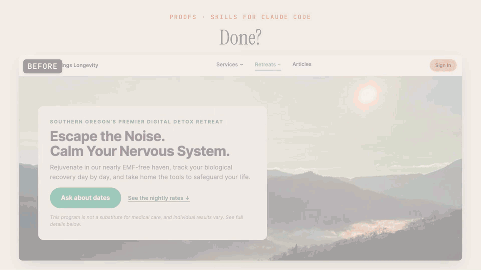</a></p>

<p align="center"><sub>The 30-second tour. Every picture is a real page, before and after. <a href="assets/clips/proofs-tour.mp4">Full-size MP4</a> (1920x1080, silent).</sub></p>

<p align="center"><a href="https://youtube.com/shorts/LGoRROsziv8">Watch the one-minute tour on YouTube</a></p>

<!-- examples:grid:start -->
## See it work

Real pages, before and after one review. [See all of them, as sliders](https://workingben.github.io/proofs/).

<p>
<a href="https://workingben.github.io/proofs/design-review.html">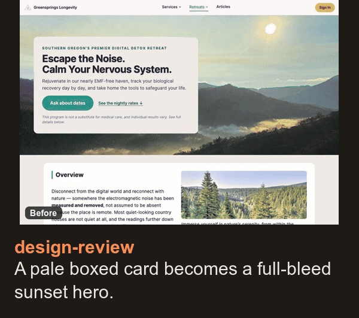</a>
<a href="https://workingben.github.io/proofs/design-review.html">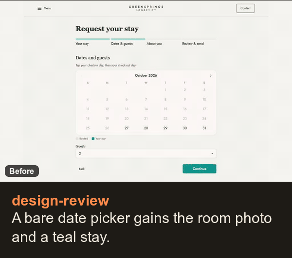</a>
<a href="https://workingben.github.io/proofs/article-copy-edit.html">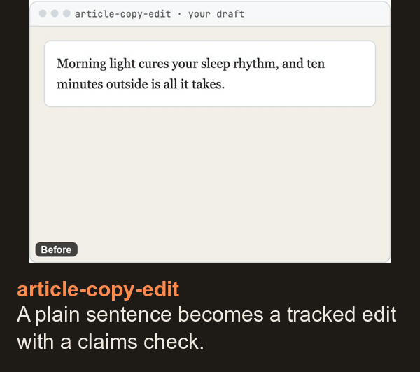</a>
<a href="https://workingben.github.io/proofs/design-review.html">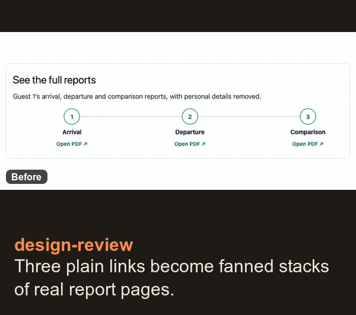</a>
</p>

<details>
<summary><b>More examples (4)</b></summary>

<p>
<a href="https://workingben.github.io/proofs/design-review.html">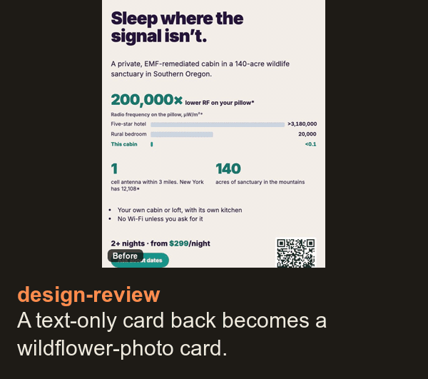</a>
<a href="https://workingben.github.io/proofs/design-review.html">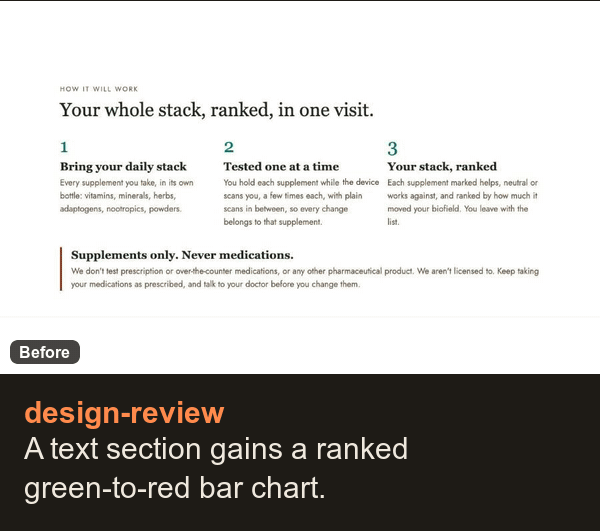</a>
<a href="https://workingben.github.io/proofs/design-review.html">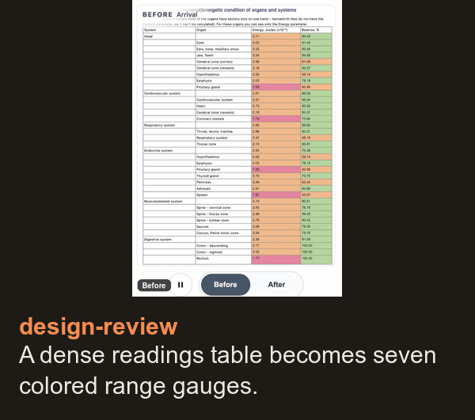</a>
<a href="https://workingben.github.io/proofs/design-review.html">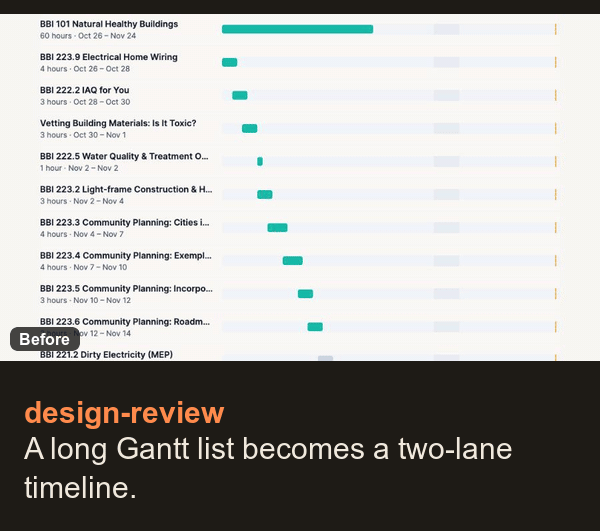</a>
</p>
</details>
<!-- examples:grid:end -->

## After installing

Ask for a skill by name, like `design review for /pricing`, or run `/proofs:visual-qa /checkout`. To get new versions later: `/plugin marketplace update proofs`.

No claude.ai artifacts? Pages open in your browser instead, or on your phone over Wi-Fi. See [Where the Page Goes](https://workingben.github.io/proofs/design-review.html#wp).

## What runs automatically

One hook, and it is off until you turn it on. At the start of each session (a `SessionStart` hook in `hooks/hooks.json`), it tells Claude how many pull requests are open in the current repo and lists them oldest first with their age, so an unreviewed one cannot sit forgotten.

- **Off by default.** It does nothing unless `PROOFS_PR_REMINDER=1` is set for the project.
- **Never blocks a session.** No token, no network, GitHub down: it exits quietly and the session starts as usual. Its one GitHub call gives up after 5 seconds.
- **Turn it on** from your project's root folder (the script edits the `.claude/settings.json` of the folder you run it in): `python3 <the proofs plugin folder>/skills/pr-qa/scripts/install_session_hook.py`. Or add `"PROOFS_PR_REMINDER": "1"` to the `"env"` block of that file yourself. It reads GitHub access from `GITHUB_TOKEN`, then `gh auth token`.

## How every skill works

<picture>
  <source media="(max-width: 700px) and (prefers-color-scheme: dark)" srcset="assets/how-it-works-steps-dark.svg">
  <source media="(max-width: 700px)" srcset="assets/how-it-works-steps-light.svg">
  <source media="(prefers-color-scheme: dark)" srcset="assets/how-it-works-row-dark.svg">
  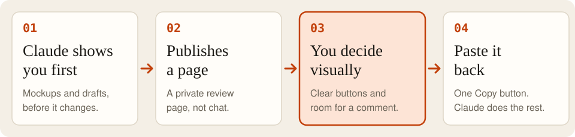
</picture>

Every skill below plugs into this loop.

### Why paste it back?

Because your agents keep working while you decide, and you can decide from anywhere, with nothing running on your computer. Tools that send your answers straight back to the agent are smoother, and they pay for it in other ways:

| | Proofs | [Lavish](https://github.com/kunchenguid/lavish-axi) | [make-pages-interactive](https://github.com/paraschopra/make-pages-interactive) |
| --- | --- | --- | --- |
| Keeps working while you decide | **Yes** | No, it waits | Yes, it watches an inbox |
| Decide on your phone | **Yes, any device** | With Tailscale | Not stated |
| Server on your computer | **None** | Yes | Yes |

Both are good tools, and neither replaces our visual communication skills.

## How it's built

Proofs is a small, tested codebase, not just a folder of prompts.

**One page builder for every skill.** Design reviews, copy edits, photo picks, style audits, questions, QA checklists and the working log all come from one builder (`shared/review_page/`). A skill writes the content as a JSON spec, and the builder makes a single self-contained page with every mechanic built in: decision buttons, variant galleries, a sticky tally, saved progress, light and dark themes, and a Copy button that falls back to a selectable text box when the clipboard is blocked. Every page is checked before it's published, and can be clicked through in a real browser (`--smoke`).

**Questions come first.** Anything waiting on you is at the top of the page, above every recap and log entry. The builder enforces it: a page that puts anything above the open questions fails its check.

**Tests and evals.**
- 97 unit and browser tests cover the builder, the exports, the site and the README tiles (`python3 -m unittest discover -s tests`).
- 50 trigger evals check that the right skill fires for a real request, that its nearest sibling doesn't, and that a plain coding request fires none (`claude plugin eval . --ablation none`). The latest run passed 108 of 108 on everyday requests and 42 of 42 on deliberately ambiguous ones.

**Repo checks.**
- `bin/check-skills` holds every skill to the same rules: a description that says when to use it, a version and a changelog.
- `bin/bump-version` bumps the plugin version whenever a commit changes what ships (skills, shared code, references, hooks), so `claude plugin update` sees every release. `bin/install-hooks` runs it, with the other checks, on every commit and merge.
- `bin/privacy-scan` blocks private names and details from ever reaching a public commit, since the examples come from real projects.

## Works with Superpowers

[Superpowers](https://github.com/obra/superpowers) is the best-known workflow skill set for Claude Code (brainstorming, plans, writing tests first, subagents), and it is excellent. It works as text in the terminal. Proofs sits next to it as the visual decision layer, not a rival: use Superpowers to plan and build, and Proofs to see and decide. This project has no affiliation with or endorsement from Superpowers.

## All 12 skills

Grouped by what you're doing. Each name opens that skill's page, with screenshots and a live example.

**See it and decide**

- [**design-review**](https://workingben.github.io/proofs/design-review.html) · *Start here*: Your live page next to one to three mockups per section. You pick, Claude builds it.
- [**pr-qa**](https://workingben.github.io/proofs/pr-qa.html) · *Critical for UI changes*: Before and after screenshots of each open pull request, with one decision per PR.
- [**questions**](https://workingben.github.io/proofs/questions.html): Claude's questions on a page, with real buttons, its pick marked and one Copy.
- [**article-copy-edit**](https://workingben.github.io/proofs/article-copy-edit.html): Line edits shown on your real article, with a claims check first.
- [**photo-picker**](https://workingben.github.io/proofs/photo-picker.html): Licensed photo candidates for every spot that needs one, in a gallery you choose from.

**Check it**

- [**visual-qa**](https://workingben.github.io/proofs/visual-qa.html): Measures pages at three screen sizes, finds layout problems, and designs the fixes.
- [**qa-checklist**](https://workingben.github.io/proofs/qa-checklist.html): The checks only you can run, each marked Pass, Fail or Couldn't test.
- [**style-guide**](https://workingben.github.io/proofs/style-guide.html): Audits the whole site for one consistent look and saves the rules you accept.

**Keep track**

- [**working-log**](https://workingben.github.io/proofs/working-log.html) · *Most used*: One page per session: what's waiting on you first, then the log, with one Copy button.
- [**review-cycle**](https://workingben.github.io/proofs/review-cycle.html): Report bugs and ideas as they come; each is fixed, reviewed or saved for later.
- [**todos**](https://workingben.github.io/proofs/todos.html): Your to-do list as a tickable page. Done items are checked before they are archived.
- [**changelog**](https://workingben.github.io/proofs/changelog.html): A "What's new" page split by month, updated at the end of every session that ships something.

## Four skills up close

### design-review: see your live page beside real mockups, then approve what ships


Claude puts a real screenshot of your page next to one to three working mockups per section. You pick one, and Claude builds it.

- A real screenshot as the Before
- Mockups drawn in your site's own fonts, colors and spacing
- One decision per item, then one paste back

[Read the design-review page](https://workingben.github.io/proofs/design-review.html)

### visual-qa: measure your pages the way people see them, then fix what fails


Opens every page at desktop, laptop and phone sizes and measures it: text too small, tap targets too tight, text cut off, too few items on the first screen. Every problem gets a mockup fix, and you get a before and after.

- Real numbers, not opinions
- Before and after screenshots
- Hands its findings to design-review

[Read the visual-qa page](https://workingben.github.io/proofs/visual-qa.html)

### working-log: never scroll endless terminal output again


Claude keeps one page per session up to date while it works. Anything waiting on you sits at the top with answer buttons, then checks only you can run, then the newest news, each with a read tick. Tap your answers, press Copy, paste. Check it from the couch on your phone, and nothing you need is buried 400 lines up.

- Questions you answer with a tap
- Read it on your phone, anywhere
- Decided items fold out of the way

[Read the working-log page](https://workingben.github.io/proofs/working-log.html)

### article-copy-edit: review copy edits word by word, with a claims check first

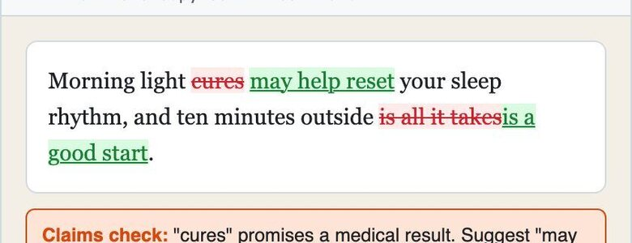

Shows the edits on a page styled like your real article. A claims check comes first, and nothing changes in your files until you have decided.

The claims check is set up for your field: medical and wellness promises, financial guarantees, legal outcomes, product-safety or environmental claims, and more. It asks once what's risky for you, remembers the answer, and also catches what every site gets wrong: guarantees, "results vary" left off, and missing affiliate disclosures.

- Keep, use, comment or revise, per edit
- A reason on every suggestion
- Risky claims flagged before anything else

[Read the article-copy-edit page](https://workingben.github.io/proofs/article-copy-edit.html)

## FAQ

<details>
<summary>Do I need anything besides Claude Code?</summary>

<br>

Review pages are published as Claude artifacts when you have them, and open in your browser otherwise. Beyond that, a few skills need small extras:

- **Python 3** for todos and pr-qa (their scripts use only the standard library).
- **`gh` (the GitHub CLI) or a GitHub token** for pr-qa.
- **Node and Playwright** for visual-qa and for screenshots.
- **Superpowers** is optional. review-cycle uses it when it is installed and works without it.

</details>

<details>
<summary>Will these work in my stack?</summary>

<br>

Any stack. The pages are plain HTML, and each skill asks your project how it starts, tests and deploys instead of assuming. They were built and tested on Rails sites, so reports from other stacks are welcome.

</details>

<details>
<summary>Can I change a skill for my own team?</summary>

<br>

Yes. Fork it, or put your house rules in your own `CLAUDE.md` and the skills will follow them.

</details>

## License

MIT. Made with Claude Code. Improvements welcome. See [LICENSE](LICENSE).
